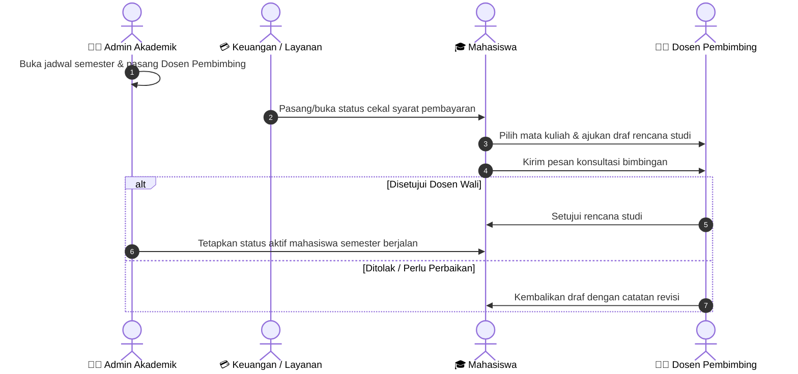

# Proses Bisnis [Nama Modul/Fitur]

> **Tujuan Dokumen:** Menjelaskan alur kerja bisnis (*probis*) kepada manusia non-programmer secara ringkas, padat, dan *to-the-point*.  
> **Tanda Penting:**
> - **`[perlu dicek manual]`** = Aturan tidak terlihat dari layar yang diobservasi.
> - **`[tidak ada di scrape]`** = Halaman terkait belum ikut terunduh.

---

## 1. Ini Fitur Apa & Siapa yang Terlibat?
*(Maksimal 3–4 kalimat pendek: apa fungsi fitur ini di kampus dan apa batasannya).*

| Peran (Role) | Tugas Utama dalam Proses Ini |
|---|---|
| **[Peran 1]** | *(1 kalimat singkat)* |
| **[Peran 2]** | *(1 kalimat singkat)* |
| **[Peran 3]** | *(1 kalimat singkat)* |

---

## 2. Diagram Alur Lintas Peran (Sequence Diagram)
*(Wajib menggunakan Mermaid `sequenceDiagram` di mana setiap kolom/aktor adalah **Peran (Role)** dan panahnya menggambarkan urutan **Proses Bisnis** dengan bahasa manusia. DILARANG menulis nama file `.html` atau nama fungsi koding di dalam diagram!)*

---

## 3. Alur Proses Bisnis (Pokok-Pokok)
*(Dibagi berdasarkan tahapan proses bisnis nyata dari awal sampai akhir, BUKAN dibagi per halaman HTML. Gunakan poin-poin pendek dan bahasa manusia sehari-hari tanpa menyebut nama file `.html`, nama variabel, atau nama fungsi kode).*

### Tahap A: [Nama Tahap Proses Bisnis 1]
* **Pelaku:** [Nama Peran]
* **Proses:**
  1. ...
  2. ...
  3. ...

### Tahap B: [Nama Tahap Proses Bisnis 2]
* **Pelaku:** [Nama Peran]
* **Proses:**
  1. ...
  2. ...

*(Lanjutkan sesuai tahapan proses bisnis).*

---

## 4. Aturan Bisnis yang Berlaku (Pokok-Pokok)

### A. Aturan yang Terlihat di Sistem Saat Ini
*(Tulis dengan bahasa manusia, misal: "Nomor SK wajib diisi maksimal 80 karakter", BUKAN `no_sk maxlength=80`)*:
* ...
* ...

### B. Aturan yang Belum Terlihat `[perlu dicek manual]` & `[tidak ada di scrape]`
* ... `[perlu dicek manual]`
* ... `[tidak ada di scrape]`

---

## 5. Keterkaitan dengan Bagian Lain
| Bagian / Urusan | Hubungannya dengan Proses Ini |
|---|---|
| **[Nama Bagian]** | *(1 kalimat singkat)* |

---

## 6. Risiko Keamanan & Kerahasiaan Data
* **Risiko 1:** *(Langsung ke pokok masalah dengan bahasa manusia, tanpa istilah teknis koding).*
* **Risiko 2:** ...

---

## 7. Kelemahan di Sistem Lama & Standar Terbaik dari Luar

| No | Urusan / Proses | Kelemahan di Sistem Lama (SEVIMA) | Standar Terbaik (Best Practice) yang Bisa Diadopsi |
|:---:|---|---|---|
| 1 | ... | *(Bahasa manusia, singkat)* | *(Bahasa manusia, singkat)* |
| 2 | ... | ... | ... |
| 3 | ... | ... | ... |

---

## 8. Keputusan Alur Kampus (Pilihan Ganda)
*(4–6 pertanyaan singkat untuk dipilih oleh pengambil keputusan)*:

1. **[Pertanyaan 1]**
   - [ ] **Opsi A (Rekomendasi):** ...
   - [ ] **Opsi B (Cara Lama):** ...
   - [ ] **Opsi C (Sederhanakan):** ...
