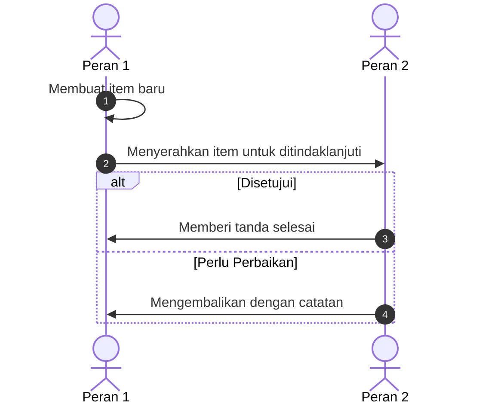

# Proses Bisnis [Nama Modul/Fitur]

> **Tujuan Dokumen:** Menjelaskan alur kerja bisnis kepada manusia non-programmer secara ringkas, padat, dan *to-the-point*.  
> **Tanda Penting:**
> - **`[perlu dicek manual]`** = Aturan belum jelas dari sumber (wawancara/dokumen/layar).
> - **`[tidak ada di sumber]`** = Bagian terkait belum tersedia di sumber yang diberikan.

---

## 1. Ini Fitur Apa & Siapa yang Terlibat?
*(Maksimal 3–4 kalimat pendek: apa fungsi fitur ini dan apa batasannya.)*

| Peran | Tugas Utama dalam Proses Ini |
|---|---|
| **[Peran 1]** | *(1 kalimat singkat)* |
| **[Peran 2]** | *(1 kalimat singkat)* |

*(Jika aplikasi tanpa login / satu pengguna, cukup satu peran "Pengguna".)*

---

## 2. Diagram Alur Lintas Peran (Sequence Diagram)
*(Wajib Mermaid `sequenceDiagram` dengan `autonumber`; setiap kolom adalah **Peran**, panah adalah langkah proses bisnis
dalam bahasa manusia. DILARANG nama file, nama tabel/kolom, atau nama fungsi.)*

---

## 3. Alur Proses Bisnis (Pokok-Pokok)
*(Dibagi per tahapan proses bisnis nyata dari awal sampai akhir, bukan per layar. Poin pendek, bahasa sehari-hari.)*

### Tahap A: [Nama Tahap 1]
* **Pelaku:** [Peran]
* **Proses:**
  1. ...
  2. ...

### Tahap B: [Nama Tahap 2]
* **Pelaku:** [Peran]
* **Proses:**
  1. ...

---

## 4. Aturan Bisnis yang Berlaku (Pokok-Pokok)

### A. Aturan yang Sudah Jelas
*(Bahasa manusia, misal: "Judul tugas wajib diisi, maksimal 120 karakter".)*
* ...

### B. Aturan yang Belum Jelas `[perlu dicek manual]` / `[tidak ada di sumber]`
* ... `[perlu dicek manual]`

---

## 5. Keterkaitan dengan Bagian Lain
| Bagian / Urusan | Hubungannya dengan Proses Ini |
|---|---|
| **[Nama Bagian]** | *(1 kalimat singkat)* |

---

## 6. Risiko Keamanan & Kerahasiaan Data
* **Risiko 1:** *(langsung ke pokok masalah, tanpa istilah teknis)*

---

## 7. Kelemahan Cara Lama & Praktik Terbaik
*(Jika ada sistem/cara lama. Jika fitur benar-benar baru, isi kolom kedua dengan "-".)*

| No | Urusan / Proses | Kelemahan Cara Lama | Praktik Terbaik yang Bisa Diadopsi |
|:---:|---|---|---|
| 1 | ... | ... | ... |

---

## 8. Keputusan Alur (Pilihan Ganda)
*(4–6 pertanyaan singkat untuk pengambil keputusan.)*

1. **[Pertanyaan 1]**
   - [ ] **Opsi A (Rekomendasi):** ...
   - [ ] **Opsi B:** ...
   - [ ] **Opsi C (Sederhanakan):** ...

---

## 9. Keputusan Final (Terkunci — Gate 1)
*(Diisi orchestrator setelah developer menjawab Bagian 8. Satu baris per keputusan.)*
