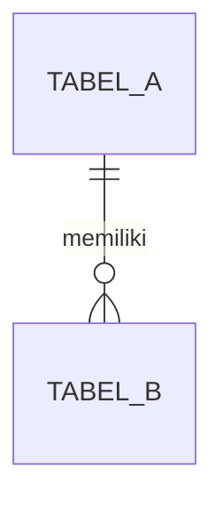

# Unified Tech Spec: [NAMA FITUR / MODUL]

> **Status:** 🟡 Menunggu Review & Approval Developer (Gate 2)  
> **Sumber Acuan:** `docs/discovery/[slug].md` (Keputusan Gate 1 Terkunci)  
> **Tech Stack:** Next.js (App Router + TypeScript) + PrimeReact + Tailwind CSS + PostgreSQL (Prisma + Zod)

---

## 1. Lingkup Teknis & Simulasi Role (Mock Auth)
*(Ringkasan padat apa yang dibangun pada spesifikasi ini dan daftar Role yang disimulasikan melalui **Role Switcher** agar fitur dapat diuji langsung tanpa menunggu modul SSO).*

| Role Simulasi | Identitas Dummy (Seed) | Hak Akses & Skenario Uji Utama |
|---|---|---|
| **Mahasiswa** | `...` | `...` |
| **Dosen Wali (DPA)** | `...` | `...` |
| **Admin Akademik / Keuangan** | `...` | `...` |

---

## 2. Spesifikasi Antarmuka, Layout Blueprint & Komponen PrimeReact
*(Daftar layar/tab, sketsa tata letak ruang, dan komponen PrimeReact yang digunakan. Langsung to-the-point).*

| Halaman / Tab | Target Role | BreadCrumb | Komponen PrimeReact Utama | Kolom Tabel / Field Input & Aksi |
|---|---|---|---|---|
| **[Nama Tab/View 1]** | `...` | `Beranda > ... > ...` | `BreadCrumb`, `DataTable`, `Skeleton`, `Tag`, `Button`, `Dialog` | • **Filter:** ...<br>• **Kolom:** ...<br>• **Aksi:** ... |
| **[Nama Tab/View 2]** | `...` | `...` | `...` | ... |

### Layout Blueprint / Wireframe Struktur (Proporsi Ruang & Hierarki Visual)
*(Wajib gambarkan sketsa blok ASCII untuk halaman utama dan dialog kompleks seperti Rincian & Konsultasi agar proporsi kolom kiri-kanan, kartu statistik, dan hierarki 1 tombol solid per area jelas sebelum dikoding di Slice 3C)*:
```text
+-----------------------------------------------------------------------------------+
| Pita Simulasi: [Ganti peran: ...]                                                 |
+-----------------------------------------------------------------------------------+
| BreadCrumb: Beranda > ... > ...                                                   |
| Judul Halaman (1.75rem/700)                       [Tombol Outlined] [Tombol Solid]|
+-----------------------------------------------------------------------------------+
| [Kartu Stat 1]     [Kartu Stat 2]     [Kartu Stat 3]     [Kartu Stat 4]           |
+-----------------------------------------------------------------------------------+
| Dialog Rincian & Konsultasi (Split-View 2 Kolom: 60% Rincian Kiri | 40% Chat Kanan)|
+-----------------------------------------------------------------------------------+
```

### Kontrak Standar UI/UX Wajib (PrimeReact Contract)
Seluruh halaman dan komponen pada fitur ini **WAJIB** menerapkan 9 standar UI berikut:
1. **Navigasi `<BreadCrumb />` & Page Header:** Setiap halaman wajib menampilkan `<BreadCrumb />` PrimeReact di bagian atas diikuti judul halaman dan deskripsi singkat 1 baris.
2. **Loading State (`<Skeleton />`):** Saat data sedang dimuat (initial fetch atau ganti filter/role), wajib menampilkan `<Skeleton />` PrimeReact atau baris skeleton pada `<DataTable>` (dilarang layar kosong/berkedip).
3. **Submit Lock (`Button Disabled & Loading`):** Setiap tombol submit/mutasi wajib menggunakan `disabled={isPending}` dan `loading={isPending}` pada `<Button />` PrimeReact untuk mencegah klik ganda (*double-submit*).
4. **Feedback Notifikasi (`<Toast />`):** Setiap hasil mutasi (sukses maupun gagal validasi) wajib memunculkan `<Toast />` PrimeReact.
5. **Konfirmasi Aksi Krusial (`<ConfirmDialog />`):** Aksi destruktif, pembatalan, atau persetujuan massal wajib melalui `<ConfirmDialog />` PrimeReact.
6. **Empty State Informatif:** Properti `emptyMessage` pada `<DataTable>` wajib menampilkan ikon dan pesan bahasa Indonesia yang jelas (bukan sekadar *"No records found"*).
7. **Standar `<DataTable>` SIAKAD (Lazy):** Daftar dari database wajib `lazy` + `paginator` + `totalRecords`, `rows={10}`, `rowsPerPageOptions={[10, 25, 50]}`, `stripedRows`, `removableSort`; halaman, urutan, dan pencarian disimpan di URL (`searchParams`) lalu diambil ulang di server dengan `skip`/`take`. Tulis di Bagian 2 tabel mana yang lazy dan parameter URL-nya.
8. **Validasi Form Inline (`p-invalid` & `p-error`):** Field input yang gagal validasi wajib diberi class `p-invalid` (garis merah) dan menampilkan pesan `<small className="p-error">` tepat di bawah field terkait.
9. **Standar Warna `<Tag />` Status:**
   - `info` (Biru) = Draf / Belum Diajukan
   - `warning` (Kuning) = Diajukan / Menunggu Persetujuan
   - `success` (Hijau) = Disetujui / Lunas / Aktif
   - `danger` (Merah) = Ditolak / Cekal / Non-Aktif

---

## 3. Aturan Validasi & Standar Guard Backend (BE Contract)

### A. Standar Arsitektur Backend Wajib (7 Pilar BE)
1. **Kontrak Response Seragam (`ActionResponse<T>`):** Semua Server Actions / API dilarang melempar *unhandled exception* ke UI, dan wajib mengembalikan:
   ```ts
   type ActionResponse<T = void> = {
     success: boolean;
     message: string;
     data?: T;
     fieldErrors?: Record<string, string[]>;
   };
   ```
2. **Validasi Input Server (`Zod`):** Seluruh input payload wajib divalidasi di sisi server menggunakan skema `Zod` sebelum mengeksekusi query database.
3. **Transaksi Atomik (`prisma.$transaction`):** Setiap mutasi yang mengubah $>1$ tabel (misal: *update status KRS* + *insert Audit Log*, atau *cek kuota kelas* + *insert KRS detail*) wajib dibungkus dalam `prisma.$transaction`.
4. **Role & Ownership Guard (`assertRole` & `assertOwnership`):** Baris pertama setiap action wajib memverifikasi bahwa `actor` memiliki role yang sesuai dan berhak atas data tersebut (misal: mahasiswa hanya boleh mengubah KRS miliknya sendiri; dosen wali hanya boleh memvalidasi mahasiswa bimbingannya). Logika keputusannya ditulis sebagai **fungsi murni** di `src/lib/[slug]/rules.ts` dan **dites** di `scripts/verify-[slug]-backend.ts`.
5. **Concurrency / Quota Guard:** Pengecekan kuota kelas (`terisi < kapasitas`) dan pencegahan bentrok jadwal wajib dilakukan di dalam transaksi database agar kuota tidak pernah bernilai minus saat terjadi akses bersamaan (*race condition*). Aturan kuota/bentrok juga fungsi murni yang dites.
6. **Audit Trail Otomatis & Anti-Hard-Delete:** Aksi krusial (persetujuan/penolakan KRS, dispensasi cekal, penetapan status semester) wajib mencatat jejak ke tabel `AuditLog` (`actorId`, `actorRole`, `action`, `entityName`, `entityId`, `reason`, `createdAt`) dan dilarang melakukan *hard-delete* pada rekaman historis akademik.
7. **Server-Side Pagination & Filtering:** Query daftar berjumlah besar wajib mendukung parameter `page`, `limit`, `search`, dan `filter` menggunakan `skip` & `take` di level database.

### B. Aturan Validasi Spesifik Fitur (Sesuai Keputusan Gate 1)
1. **[Aturan 1]:** ...
2. **[Aturan 2]:** ...

---

## 4. Skema Database PostgreSQL & Rencana Seeder

### A. Diagram Relasi Tabel (ERD Ringkas)


### B. Definisi Tabel BARU Modul Ini (Fragmen `prisma/modules/[slug].prisma`)
*(`prisma/schema.prisma` adalah schema BERSAMA. Tulis HANYA model & enum yang belum ada. Model yang sudah ada (lihat schema.prisma) cukup DIREFERENSIKAN lewat relasi — jangan didefinisikan ulang. Tabel stub referensi hanya dibuat bila memang belum ada di schema. Jika fitur ini mengharuskan mengubah/menghapus model lama, tulis di sub-bagian "Perubahan Model Lama (Manual)" di bawah — itu dikerjakan developer, bukan AI).*

```prisma
// [Model & enum baru beserta tipe data, indeks, dan relasi ke model yang sudah ada]
```

**Perubahan Model Lama (Manual):** *(kosongkan jika tidak ada)*

### C. Skenario Data Uji (`seed`)
*(Daftar data awal yang wajib di-seed otomatis pada Tahap 3A agar seluruh skenario positif & negatif bisa langsung dicoba di browser)*:
* ...

---

## 5. Kontrak Server Actions / API
| Nama Action | Role Diizinkan | Input Payload (`Zod`) | Validasi & Transaksi DB (`$transaction`) | Return (`ActionResponse<T>`) |
|---|---|---|---|---|
| `...` | `...` | `{ ... }` | 1. Guard Role & Ownership<br>2. ...<br>3. Tulis `AuditLog` | `{ success, message, data, fieldErrors }` |

---

## 6. Tabel Checklist Task Eksekusi (Pause & Resume — Tahap 3)
*(Gunakan tabel di bawah ini agar pengerjaan Tahap 3 dapat dicicil sebagian, di-pause saat waktu/token terbatas, dan dilanjutkan kembali dari baris pertama yang masih berstatus `[ ] Belum`)*:

*(Kolom "File Target" dicek otomatis oleh `kaf-code.mjs`: file/folder yang ditulis di sini WAJIB ada setelah slice selesai. Path harus mengikuti `bundle-format-rules.md` §4 — rute halaman = `/[slug]`, maks 400 baris per file. `src/lib/auth.ts` hanya dicantumkan bila modul ini modul PERTAMA (belum ada di schema/kode).)*

| Kode Task | Slice & Model | Status | File Target | Deskripsi Tugas & Kriteria Selesai |
|---|---|---|---|---|
| `T3A.1` | **3A — DB & Seed** (`sol`) | `[ ] Belum` | `prisma/modules/[slug].prisma` | Model & enum BARU saja (model lama hanya direferensikan); lulus penggabungan otomatis, `prisma validate` & `generate`. |
| `T3A.2` | **3A — DB & Seed** (`sol`) | `[ ] Belum` | `prisma/seeds/[slug].ts` | Seeder mandiri & idempoten untuk role simulasi serta skenario positif & negatif, tanpa menghapus data modul lain. |
| `T3B.1` | **3B — Backend** (`sol`) | `[ ] Belum` | `src/lib/validations/[slug].ts`, `src/lib/[slug]/rules.ts` | Schema Zod & DTO; aturan bisnis + guard peran/kepemilikan/kuota sebagai fungsi murni. |
| `T3B.2` | **3B — Backend** (`sol`) | `[ ] Belum` | `src/actions/[slug]/` | Server Actions dipecah per peran (`<peran>.ts`) + `queries.ts` (skip/take), memakai `$transaction`, `AuditLog`, dan fungsi di `rules.ts`. |
| `T3B.3` | **3B — Backend** (`sol`) | `[ ] Belum` | `scripts/verify-[slug]-backend.ts` | Tes otomatis: pemilik vs bukan pemilik, peran salah, kuota penuh, dan tiap aturan Gate 1 (lolos + ditolak). |
| `T3C.1` | **3C — UI PrimeReact** (`claude`) | `[ ] Belum` | `src/app/[slug]/page.tsx`, `src/app/[slug]/loading.tsx` | Halaman `async` Server Component (baca `searchParams`, fetch di server) dan boundary `<Skeleton />`. |
| `T3C.2` | **3C — UI PrimeReact** (`claude`) | `[ ] Belum` | `src/components/[slug]/` | Komponen client dipecah per area (maks 400 baris/file): Role Switcher, BreadCrumb, Toast, ConfirmDialog, tabel lazy, form & validasi inline. |
| `T3C.3` | **3C — UI PrimeReact** (`claude`) | `[ ] Belum` | `src/app/[slug]/[id]/cetak/page.tsx` | (Opsional, hapus baris ini jika tidak perlu) Halaman pendukung/cetak hingga seluruh skenario role siap UAT. |


