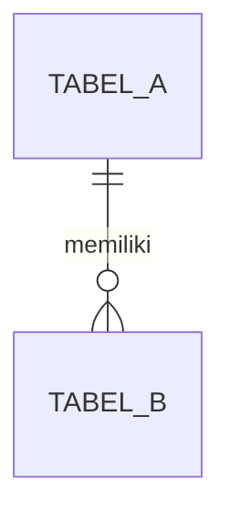

# Unified Tech Spec: [NAMA FITUR / MODUL]

> **Status:** 🟡 Menunggu Review & Approval Developer (Gate 2)  
> **Sumber Acuan:** `docs/discovery/[slug].md` (Keputusan Gate 1 Terkunci)  
> **Tech Stack:** sesuai `kaf.config.json` (`stack`) · Rute halaman: `/[slug]`

---

## 1. Lingkup Teknis & Peran
*(Ringkasan padat apa yang dibangun. Isi tabel peran sesuai `auth.mode` di `kaf.config.json`:
`demo` → peran disimulasikan lewat Role Switcher + akun seed; `existing` → peran dari sistem login yang sudah ada;
`none` → tulis "Tanpa login (satu pengguna)" dan hapus tabel).*

| Peran | Identitas Uji (Seed) | Hak Akses & Skenario Uji Utama |
|---|---|---|
| **[Peran 1]** | `...` | `...` |
| **[Peran 2]** | `...` | `...` |

---

## 2. Spesifikasi Antarmuka, Layout Blueprint & Komponen
*(Daftar layar/tab, sketsa tata letak, dan komponen dari library di `stack.ui`. Langsung to-the-point.)*

| Halaman / Tab | Peran | Breadcrumb | Komponen Utama | Kolom Tabel / Field Input & Aksi | Tabel Lazy? (param URL) |
|---|---|---|---|---|---|
| **[Nama View 1]** | `...` | `Beranda > ...` | `...` | • **Filter:** ...<br>• **Kolom:** ...<br>• **Aksi:** ... | `page, limit, q, sort` |
| **[Nama View 2]** | `...` | `...` | `...` | ... | `-` |

### Layout Blueprint / Wireframe (Proporsi Ruang & Hierarki Visual)
*(Wajib sketsa blok ASCII untuk halaman utama dan dialog kompleks, agar proporsi kolom, kartu, dan hierarki
1 tombol utama per area jelas sebelum dikoding di Slice 3C.)*
```text
+-----------------------------------------------------------------------------------+
| (auth.mode = demo) Pita simulasi peran: [Ganti peran: ...]                        |
+-----------------------------------------------------------------------------------+
| Breadcrumb: Beranda > ...                                                         |
| Judul Halaman                                     [Tombol Sekunder] [Tombol Utama]|
+-----------------------------------------------------------------------------------+
| [Isi utama: tabel / papan / form sesuai fitur]                                    |
+-----------------------------------------------------------------------------------+
```

### Kontrak Standar UI/UX Wajib
Seluruh halaman dan komponen **WAJIB** menerapkan 9 standar berikut (nama komponen menyesuaikan `stack.ui`;
contoh dalam kurung untuk PrimeReact):
1. **Breadcrumb & Page Header** di setiap halaman, diikuti judul dan deskripsi singkat 1 baris (`<BreadCrumb />`).
2. **Loading State:** skeleton saat data dimuat atau filter berganti, dilarang layar kosong/berkedip (`<Skeleton />`, `loading.tsx`).
3. **Submit Lock:** tombol mutasi `disabled` + indikator loading selama proses (`<Button disabled={isPending} loading={isPending} />`).
4. **Feedback Notifikasi** untuk setiap hasil mutasi (`<Toast />`).
5. **Konfirmasi Aksi Krusial** untuk aksi destruktif, pembatalan, atau massal (`<ConfirmDialog />`).
6. **Empty State Informatif** dengan ikon dan pesan berbahasa `project.language` (bukan *"No records found"*).
7. **Tabel Data Lazy:** daftar dari database dipaginasi di server; halaman/urutan/pencarian disimpan di URL (`searchParams`)
   (`<DataTable lazy paginator totalRecords={total} rows={10} rowsPerPageOptions={[10, 25, 50]} />`).
8. **Validasi Form Inline:** field salah ditandai dan pesan tampil tepat di bawahnya (`p-invalid` + `<small className="p-error">`).
9. **Warna Status Konsisten:** `info` = draf/baru · `warning` = menunggu/proses · `success` = selesai/aktif · `danger` = ditolak/terlambat/nonaktif (`<Tag />`).

---

## 3. Aturan Validasi & Standar Guard Backend (BE Contract)

### A. Standar Arsitektur Backend Wajib (7 Pilar BE)
1. **Kontrak Response Seragam (`ActionResponse<T>`):** Server Actions dilarang melempar *unhandled exception* ke UI, dan wajib mengembalikan:
   ```ts
   type ActionResponse<T = void> = {
     success: boolean;
     message: string;
     data?: T;
     fieldErrors?: Record<string, string[]>;
   };
   ```
2. **Validasi Input Server:** seluruh payload divalidasi di server (`stack.validation`, bawaan Zod) sebelum query database.
3. **Transaksi Atomik (`prisma.$transaction`):** setiap mutasi yang mengubah > 1 tabel (mis. pindah kartu + catat riwayat) wajib dalam satu transaksi.
4. **Guard Peran & Kepemilikan** *(lewati bila `auth.mode = none`)*: baris pertama setiap action memastikan peran sesuai dan data milik/berhak
   diakses pengguna aktif. Logika keputusannya ditulis sebagai **fungsi murni** di `src/lib/[slug]/rules.ts` dan **dites**.
5. **Batas / Kuota / Konflik di Dalam Transaksi:** aturan seperti batas jumlah, kapasitas, urutan, atau bentrok jadwal dicek di dalam transaksi
   agar aman saat akses bersamaan. Aturannya juga fungsi murni yang dites.
6. **Jejak Perubahan & Anti-Hard-Delete** *(jika data penting)*: aksi krusial dicatat (siapa, apa, kapan, alasan); data historis
   diarsipkan, bukan dihapus permanen.
7. **Server-Side Pagination & Filtering:** query daftar mendukung `page`, `limit`, `search`, `filter` dengan `skip`/`take` dan
   mengembalikan `{ rows, total, page, limit }`.

### B. Aturan Validasi Spesifik Fitur (Sesuai Keputusan Gate 1)
1. **[Aturan 1]:** ...
2. **[Aturan 2]:** ...

---

## 4. Skema Database & Rencana Seeder

### A. Diagram Relasi Tabel (ERD Ringkas)


### B. Definisi Tabel BARU Modul Ini (Fragmen `prisma/modules/[slug].prisma`)
*(`prisma/schema.prisma` adalah schema BERSAMA. Tulis HANYA model & enum yang belum ada. Model yang sudah ada cukup
DIREFERENSIKAN lewat relasi — jangan didefinisikan ulang. Jika fitur ini mengharuskan mengubah/menghapus model lama,
tulis di "Perubahan Model Lama (Manual)" — itu dikerjakan developer, bukan AI.)*

```prisma
// [Model & enum baru beserta tipe data, indeks, dan relasi ke model yang sudah ada]
```

**Perubahan Model Lama (Manual):** *(kosongkan jika tidak ada)*

### C. Skenario Data Uji (`seed`)
*(Data awal yang di-seed di Tahap 3A agar skenario positif & negatif bisa langsung dicoba di browser.)*
* ...

---

## 5. Kontrak Server Actions
| Nama Action | Peran Diizinkan | Input Payload | Validasi & Transaksi DB | Return (`ActionResponse<T>`) |
|---|---|---|---|---|
| `...` | `...` | `{ ... }` | 1. Guard (fungsi di `rules.ts`)<br>2. ...<br>3. Catat jejak bila krusial | `{ success, message, data, fieldErrors }` |

---

## 6. Tabel Checklist Task Eksekusi (Pause & Resume — Tahap 3)
*(Gunakan tabel di bawah ini agar pengerjaan Tahap 3 dapat dicicil, di-pause, dan dilanjutkan dari baris pertama yang masih `[ ] Belum`.)*

*(Kolom "File Target" dicek otomatis oleh `kaf-code.mjs`: file/folder yang ditulis di sini WAJIB ada setelah slice selesai.
Path mengikuti `bundle-format-rules.md` §4 — rute halaman = `/[slug]`, maks `maxLines` baris per file.
`src/lib/auth.ts` hanya dicantumkan bila `auth.mode = demo` DAN belum ada di proyek.)*

| Kode Task | Slice & Model | Status | File Target | Deskripsi Tugas & Kriteria Selesai |
|---|---|---|---|---|
| `T3A.1` | **3A — DB & Seed** | `[ ] Belum` | `prisma/modules/[slug].prisma` | Model & enum BARU saja (model lama hanya direferensikan); lulus penggabungan otomatis, `prisma validate` & `generate`. |
| `T3A.2` | **3A — DB & Seed** | `[ ] Belum` | `prisma/seeds/[slug].ts` | Seeder mandiri & idempoten untuk skenario positif & negatif, tanpa menghapus data modul lain. |
| `T3B.1` | **3B — Backend** | `[ ] Belum` | `src/lib/validations/[slug].ts`, `src/lib/[slug]/rules.ts` | Schema validasi & DTO; aturan bisnis + guard sebagai fungsi murni. |
| `T3B.2` | **3B — Backend** | `[ ] Belum` | `src/actions/[slug]/` | Server Actions dipecah per peran/area + `queries.ts` (skip/take), memakai `$transaction` dan fungsi di `rules.ts`. |
| `T3B.3` | **3B — Backend** | `[ ] Belum` | `scripts/verify-[slug]-backend.ts` | Tes otomatis tiap aturan (lolos + ditolak); bila ada login: pemilik vs bukan pemilik & peran salah. |
| `T3C.1` | **3C — UI** | `[ ] Belum` | `src/app/[slug]/page.tsx`, `src/app/[slug]/loading.tsx` | Halaman `async` Server Component (baca `searchParams`, fetch di server) dan boundary skeleton. |
| `T3C.2` | **3C — UI** | `[ ] Belum` | `src/components/[slug]/` | Komponen client dipecah per area (maks `maxLines` baris/file) memenuhi 9 Kontrak UI. |
